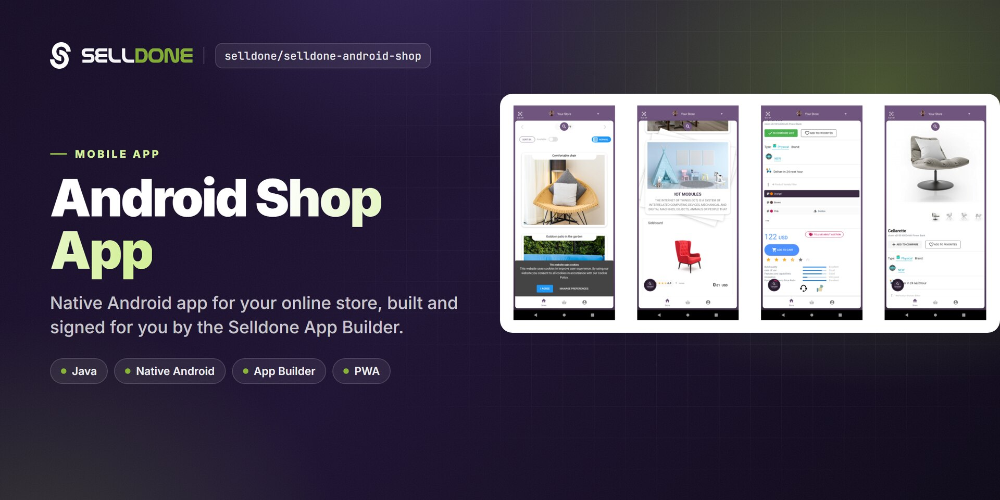
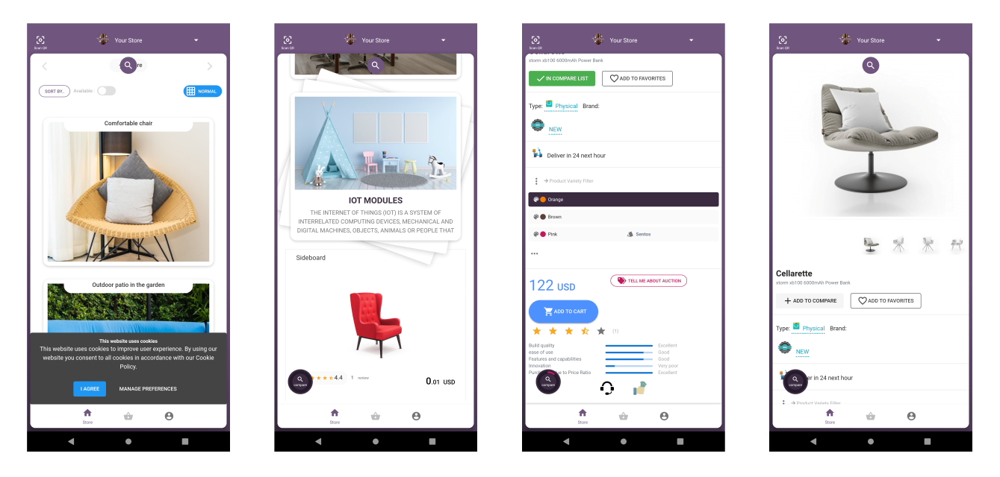

<p align="center">
  
</p>

<p align="center">
  <a href="LICENSE"></a>
  <a href="https://github.com/selldone/selldone-android-shop/wiki"></a>
  <a href="https://selldone.com"></a>
</p>

<p align="center">
  <b>The open-source Android app behind Selldone App Builder — build an Android application for your online store.</b><br>
  <a href="https://github.com/selldone/selldone-android-shop/wiki">Documentation</a> ·
  <a href="#quick-start">Quick start</a> ·
  <a href="https://github.com/selldone">Ecosystem</a> ·
  <a href="https://selldone.com">Selldone.com</a> ·
  <a href="https://github.com/selldone/selldone-android-shop/issues">Report an issue</a>
</p>

<p align="center">
  <a href="https://github.com/selldone/storefront">Storefront</a> ·
  <a href="https://github.com/selldone/pagebuilder">Page Builder</a> ·
  <a href="https://github.com/selldone/components">Components</a> ·
  <a href="https://github.com/selldone/storefront-sdk">Storefront SDK</a> ·
  <a href="https://github.com/selldone/backoffice-sdk">Backoffice SDK</a> ·
  <a href="https://github.com/selldone/vendor-sdk">Vendor SDK</a> ·
  <a href="https://github.com/selldone/community-sdk">Community SDK</a> ·
  <a href="https://github.com/selldone/core">Core</a> ·
  <a href="https://github.com/selldone/cli">CLI</a> ·
  <a href="https://github.com/selldone/translate">Translate</a>
</p>

## Overview

**Selldone®** Store Application for Android lets you build an Android application for your online store. It is a native Java app that loads your shop's Progressive Web App (PWA) in a full-screen WebView and adds native parts around it: a toolbar, bottom navigation, login through the system browser, QR codes and push notifications.

Most merchants never need to touch this code. [Selldone App Builder](https://selldone.com/app-builder) builds and signs the app on Selldone's servers from a name, title, icon and splash screen — no code required. This repository is for developers who want to see how the app works, customize it beyond the App Builder options, or build and sign it themselves.

<p align="center">
  
</p>

## Key features

- **PWA inside a native shell** — loads `https://selldone.com/@{shop_name}?native=true` in a WebView with JavaScript, DOM storage and geolocation enabled.
- **Native navigation** — bottom navigation (Store, Basket, Profile/Login) and a top toolbar that drive the PWA through `GoToPath(...)`.
- **Two-way JavaScript bridge** — the PWA calls `Android.passShop(...)` and `Android.passUser(...)`; the app calls `SetToken(...)`, `NativeLogout()` and `GoToPath(...)` in the page.
- **Browser-based login** — opens the shop login page in the browser and receives the token back through the custom scheme `selldone://{shop_name}.callback`.
- **Push notifications** — Firebase Cloud Messaging service for order updates.
- **QR codes** — scan and show QR codes (ZXing / ZBar).
- **White-label ready** — app name, shop name, splash, package ID and version are placeholders that the App Builder fills automatically.
- **Release signing** — signing config is read from a `keystore.properties` file.

## Screenshots

<p align="center">
  
</p>

## Quick start

### Option A — Selldone App Builder (no code)

You only need to set a name, title, icon and splash screen design, then build the app. The Selldone server-side app builder builds the application and signs it with your sign keys. The app is then ready for release in app stores.

Visit the [Selldone App Builder](https://selldone.com/app-builder): **one click to build your Android app and publish it**.

### Option B — Build from source

Requirements: Android Studio, JDK 8 (the CI workflow uses Java 1.8), Android SDK 28.

```bash
git clone https://github.com/selldone/selldone-android-shop.git
cd selldone-android-shop
```

1. **Set your shop** in `app/src/main/res/values/shop_info.xml` — `shop_name` is your shop username (`selldone.com/@mobile` → `mobile`), plus `app_name`, `shop_title` and the splash texts and color.
2. **Set the app identity** in `app/build.gradle` — `applicationId`, `versionCode`, `versionName` and `manifestPlaceholders = [shopName: "..."]` (use the same value as `shop_name`; it defines the login callback host).
3. **Add signing keys** — create `keystore.properties` in the project root (the build loads it unconditionally):

   ```properties
   storeFile=/absolute/path/to/your-release-key.jks
   storePassword=********
   keyAlias=your-key-alias
   keyPassword=********
   ```

4. **Check `gradle.properties`** — it sets an HTTP proxy (`systemProp.http.proxyHost=127.0.0.1`, `systemProp.http.proxyPort=8090`). Remove or change these lines if you do not use that proxy.
5. **Build** a signed release:

   ```bash
   gradlew assembleRelease
   ```

   The repository contains `gradle/wrapper/gradle-wrapper.properties` (Gradle 5.6.4) but not the `gradlew` scripts. Open the project in Android Studio, or generate the wrapper with a local Gradle installation (`gradle wrapper --gradle-version 5.6.4`).

See [Build from Source](https://github.com/selldone/selldone-android-shop/wiki/Build-from-Source) for details and troubleshooting.

## Usage

### App Builder vs building from source

| | Selldone App Builder | Build from source |
|---|---|---|
| Who it is for | Merchants, no coding | Android developers |
| What you provide | Name, title, icon, splash design, sign keys | Code changes, keystore, build environment |
| Build and signing | On Selldone servers | On your machine or CI |
| Customization | App Builder options | Anything in the code |
| Updates | Rebuild from the dashboard | Merge and rebuild yourself |

### Project structure

```text
selldone-android-shop/
├── build.gradle                    # Android Gradle Plugin 3.6.1, repositories
├── settings.gradle                 # include ':app'
├── gradle.properties               # AndroidX, JVM args, HTTP proxy settings
├── gradle/wrapper/gradle-wrapper.properties   # Gradle 5.6.4
├── .github/workflows/android.yml   # CI: JDK 1.8, ./gradlew build
└── app/
    ├── build.gradle                # app id, versions, signing, dependencies (✎ auto-filled by App Builder)
    └── src/main/
        ├── AndroidManifest.xml     # MainActivity, deep link selldone://{shopName}.callback, FCM service
        ├── java/selldone/
        │   ├── AppController.java          # Application class
        │   ├── activities/MainActivity.java # WebView, navigation, login, JS interface
        │   ├── routes/ShopRoute.java        # GoToPath(...) helpers for PWA pages
        │   ├── api/ShopHelperMethods.java   # image, shop icon and avatar URLs
        │   ├── fcm/                         # Firebase messaging service
        │   ├── models/                      # Shop, User, Basket, Product, ...
        │   ├── helpers/                     # colors, formatting, bitmaps, QR codes
        │   ├── messages/                    # order update notification model
        │   └── ui/                          # fragments, toolbar, gestures
        └── res/
            ├── values/shop_info.xml         # app_name, shop_title, shop_name, splash (✎ auto-filled)
            ├── layout/, menu/, drawable/, mipmap-*/, raw/ ...
```

Values marked `✎ Script ➔ Auto fill` in the source are filled by the App Builder when it builds your app.

### Application Builder


## Documentation

| Page | What you'll learn |
|---|---|
| [Home](https://github.com/selldone/selldone-android-shop/wiki) | What the app is and how it relates to App Builder. |
| [Getting Started](https://github.com/selldone/selldone-android-shop/wiki/Getting-Started) | Choose App Builder or source, and get a first build. |
| [App Builder](https://github.com/selldone/selldone-android-shop/wiki/App-Builder) | Build and sign your app on Selldone without code. |
| [Build from Source](https://github.com/selldone/selldone-android-shop/wiki/Build-from-Source) | Toolchain, keystore, Gradle and release builds. |
| [Configuration](https://github.com/selldone/selldone-android-shop/wiki/Configuration) | Every value to change for your own store. |
| [Architecture](https://github.com/selldone/selldone-android-shop/wiki/Architecture) | WebView + PWA, JavaScript bridge, login and notifications. |
| [FAQ](https://github.com/selldone/selldone-android-shop/wiki/FAQ) | Common questions and troubleshooting. |

## How it fits in the ecosystem

The Android app is a native shell around your shop's web storefront on Selldone. Everything inside the WebView — products, basket, checkout, profile — is the same storefront your customers use on the web, so changes to your store appear in the app immediately.

<p align="center">
  <a href="https://github.com/selldone#ecosystem"></a>
</p>

### Related projects

| Project | Why it is relevant |
|---|---|
| [storefront](https://github.com/selldone/storefront) | Production-ready Vue 3 storefront (a Selldone Layout). |
| [storefront-sdk](https://github.com/selldone/storefront-sdk) | Customer-facing API client: products, basket, auth, user. |
| [components](https://github.com/selldone/components) | Pre-built Vue 3 commerce components. |
| [storefront-playground](https://github.com/selldone/storefront-playground) | Minimal Storefront SDK starter. |

## Contributing

Contributions are welcome. Please read the organization [contributing guide](https://github.com/selldone/.github/blob/main/CONTRIBUTING.md) and [code of conduct](https://github.com/selldone/.github/blob/main/CODE_OF_CONDUCT.md). Never commit `keystore.properties`, keystores or passwords.

## Security

Please do not report security vulnerabilities in public issues. Follow the [security policy](https://github.com/selldone/.github/blob/main/SECURITY.md) and email **security@selldone.com**.

## License

Released under the MIT License. See [LICENSE](LICENSE).

<details>
<summary>MIT License</summary>

    MIT License

    Copyright (c) 2020 Selldone

    Permission is hereby granted, free of charge, to any person obtaining a copy
    of this software and associated documentation files (the "Software"), to deal
    in the Software without restriction, including without limitation the rights
    to use, copy, modify, merge, publish, distribute, sublicense, and/or sell
    copies of the Software, and to permit persons to whom the Software is
    furnished to do so, subject to the following conditions:

    The above copyright notice and this permission notice shall be included in all
    copies or substantial portions of the Software.

    THE SOFTWARE IS PROVIDED "AS IS", WITHOUT WARRANTY OF ANY KIND, EXPRESS OR
    IMPLIED, INCLUDING BUT NOT LIMITED TO THE WARRANTIES OF MERCHANTABILITY,
    FITNESS FOR A PARTICULAR PURPOSE AND NONINFRINGEMENT. IN NO EVENT SHALL THE
    AUTHORS OR COPYRIGHT HOLDERS BE LIABLE FOR ANY CLAIM, DAMAGES OR OTHER
    LIABILITY, WHETHER IN AN ACTION OF CONTRACT, TORT OR OTHERWISE, ARISING FROM,
    OUT OF OR IN CONNECTION WITH THE SOFTWARE OR THE USE OR OTHER DEALINGS IN THE
    SOFTWARE.

</details>

---
<p align="center"><sub>Part of the <a href="https://github.com/selldone">Selldone® Business OS</a> open-source ecosystem · <a href="https://selldone.com">selldone.com</a></sub></p>
